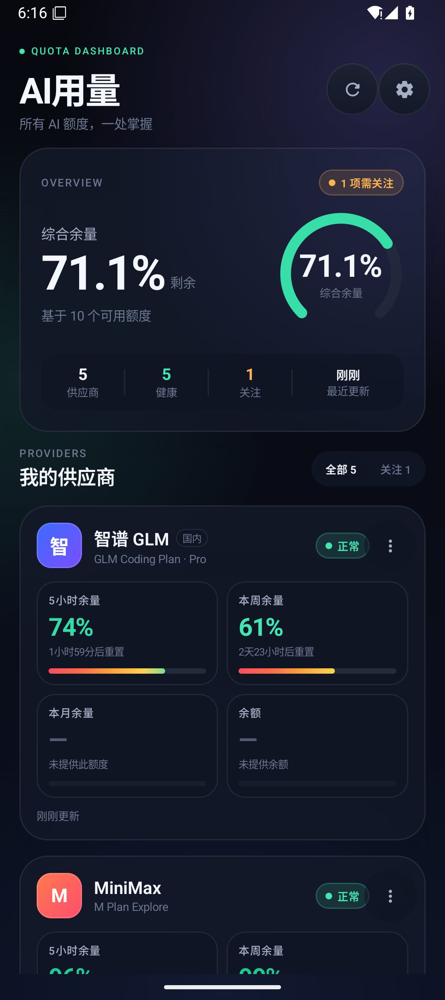
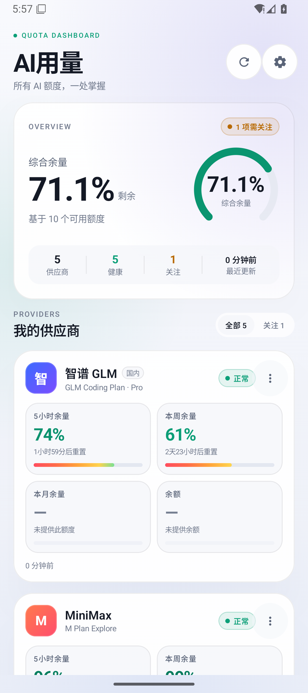
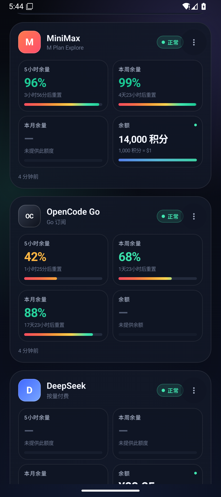
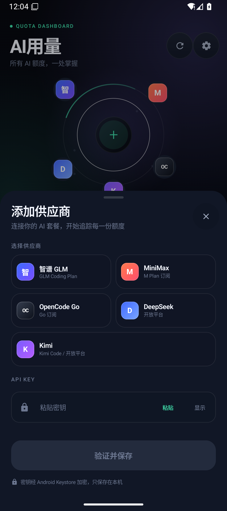
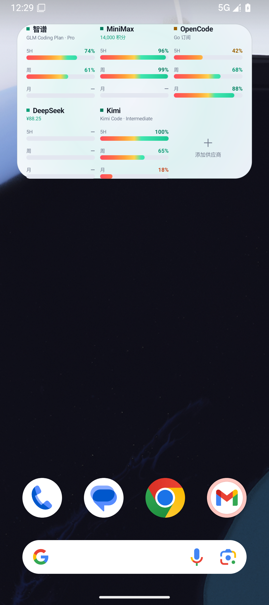
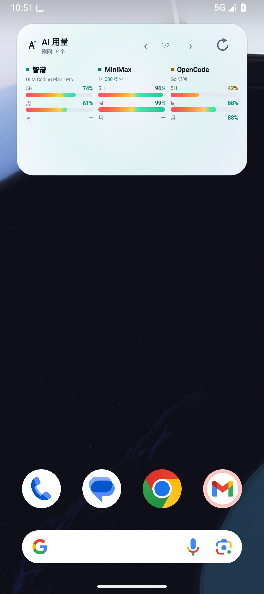
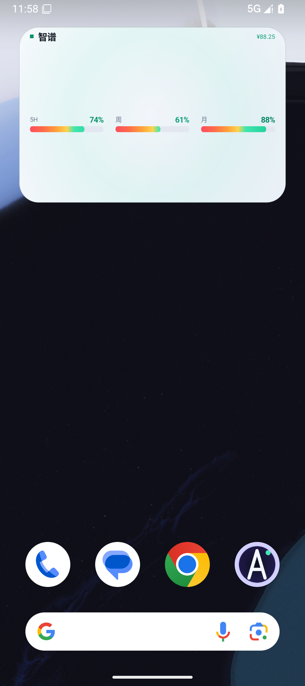
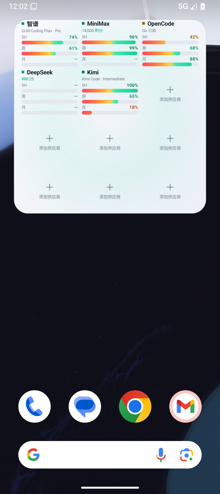
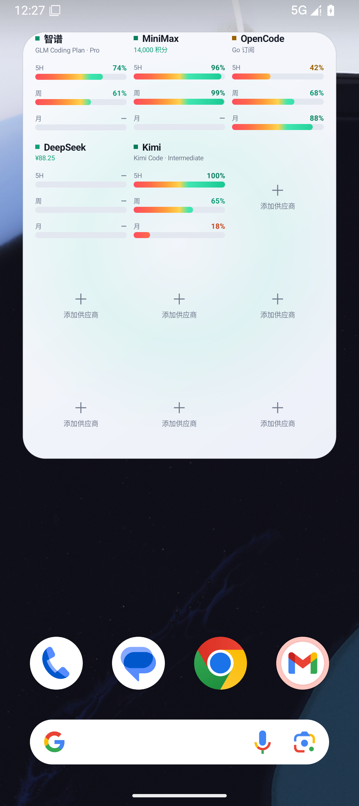
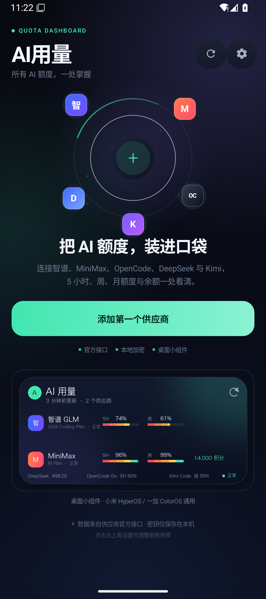

# AI用量

一个为 Android 设计的 AI 订阅额度看板。输入各家的 API Key 后，在一个界面里查看 **5 小时额度、周额度、月额度、余额**，并通过小米 HyperOS / 一加 ColorOS 的系统桌面小组件随时查看。

> 本项目与智谱、MiniMax、OpenCode、DeepSeek、Kimi 均无隶属关系。所有数据直接来自各供应商官方接口。

## 界面预览

| 深色 · 首页 | 浅色 · 首页 |
| --- | --- |
|  |  |

| 供应商卡片 | 添加供应商 |
| --- | --- |
|  |  |

| 桌面小组件 · 深色 | 桌面小组件 · 浅色 |
| --- | --- |
|  |  |

| 小组件 · 单家三列条 | 小组件 · 4×3 | 小组件 · 4×4 |
| --- | --- | --- |
|  |  |  |

| 空状态 |
| --- |
|  |

更多：`docs/screenshots/`。

## 已支持的供应商

| 供应商 | 识别方式 | 5 小时 | 周额度 | 月额度 | 余额 |
| --- | --- | --- | --- | --- | --- |
| 智谱 GLM | BigModel / Z.ai API Key | ✅ | ✅ | — | — |
| MiniMax | M Plan 订阅 Key（`sk-cp-…`） | ✅ | ✅（套餐支持时） | — | ✅ 积分 |
| OpenCode Go | OpenCode API Key | ✅ | ✅ | ✅ | — |
| DeepSeek | 开放平台 API Key | — | — | — | ✅ |
| Kimi Code | Kimi Code Key（`sk-kimi-…`） | ✅ | ✅ | ✅（接口返回时） | — |
| Kimi 开放平台 | Moonshot API Key | — | — | — | ✅ |

不支持的额度会保持与其它格子完全一致的布局，只做置灰显示，不会让卡片“缺一块”。

## 设计

- 深色 Aurora / 玻璃拟态风格，浅色主题可切换
- 红 → 橙 → 黄 → 绿的全宽渐变额度条，数值越高越绿；剩余 ≥60% 进入绿色安全区
- 统一的 2×2 额度格子：5 小时 / 本周 / 本月 / 余额
- 综合余量环形仪表、供应商健康度、告警筛选
- 适配小米 HyperOS 与一加 ColorOS 的标准 Android AppWidget，可缩放为 2×2 / 4×2 / 4×3
- 小组件跟随 App 主题设置；选择「跟随系统」时，深/浅色随系统切换
- 小组件采用三列供应商卡片：每张卡片内 `5H / 周 / 月` 三条横向额度条纵向排列，余额或套餐名放在供应商标题下方
- 行高由当前手机的字体度量（Paint.FontMetrics + Resolution/fontScale）动态计算，供应商卡片不再使用固定高度裁剪；列距 8dp、行距 7dp、外边距 15/10dp 固定，调整高度只增加可见行数，已有供应商的位置和相对高度不动
- 每多一行高度增加 3 个供应商槽位；3×4 起至少两行，具体行数由桌面实际高度决定，空余槽位显示“＋ 添加供应商”
- 小组件没有翻页：1 格 1 家、2 格 3 家、3 格 5 家、4 格 7 家（2N−1，上限 15 家），多出的供应商请拉高组件查看
- 行内不再有翻页箭头；刷新按钮为 34×34 触摸区，点击供应商行或页眉文字区打开主程序
- 进度条为圆角平滑渐变，99% 精确显示；浅色模式同样使用明亮的红→绿渐变

设计说明与参考案例见 [docs/DESIGN.md](docs/DESIGN.md)。接口细节见 [docs/API.md](docs/API.md)。

## 安装包

- `dist/AIUsage-1.0.0.apk`：R8 压缩后的 release 构建，方便直接安装。当前使用 Android 调试证书签名，仅适合个人侧载；正式分发前请换成你自己的 release keystore。
- 构建自己的 APK：`./gradlew :app:assembleRelease`，产物在 `app/build/outputs/apk/release/`，签名后侧载到手机即可。开发者在本地转发时也可以使用 `./scripts/serve_apk.sh`（需先自行构建并放到 `dist/`）。
- `app/build/outputs/apk/debug/app-debug.apk`：调试构建，包名为 `com.aiusage.app.debug`，包含演示数据接收器，方便截图与小组件调试。

```bash
adb install -r dist/AIUsage-1.0.0.apk
# 或
adb install -r app/build/outputs/apk/debug/app-debug.apk
```

## 构建

环境要求：JDK 17+、Android SDK 36。Gradle Wrapper 默认使用腾讯镜像下载 Gradle 8.13；如在海外或镜像不可用，可改回 `services.gradle.org`。

```bash
./gradlew :app:assembleDebug
./gradlew :app:testDebugUnitTest
./gradlew :app:connectedDebugAndroidTest
./gradlew :app:lintDebug
./gradlew :app:assembleRelease
```

## 使用

1. 打开 App，点击「添加第一个供应商」。
2. 选择供应商，粘贴对应控制台创建的 Key。
3. 大多数供应商支持「自动 / 国内 / 国际」区域选择；默认自动会依次尝试。
4. 保存后会立即验证并拉取一次额度。

### Key 从哪里来

- **智谱**：BigModel 或 Z.ai 控制台 → API Key。订阅 GLM Coding Plan 后才有额度数据。
- **MiniMax**：M Plan 控制台 → Subscription Key（`sk-cp-…`）。普通按量付费 Key 无法读取订阅额度。
- **OpenCode Go**：opencode.ai 控制台 → Go / Go Plus API Key。
- **DeepSeek**：platform.deepseek.com → API Keys。
- **Kimi**：Kimi Code 控制台 → API Key（`sk-kimi-…`）用于额度；Moonshot 开放平台 Key 用于余额。

### 桌面小组件

1. 长按桌面空白处 → 小部件 / 添加小部件。
2. 搜索「AI用量」，选择 4×2 小组件。
3. 拖到桌面，可自由缩放。
4. 小组件为流动列表：双行大标题（标题 / 更新时间 · 供应商数量 / 刷新按钮），下方一行一个供应商：状态色方块 + 名称 + 右缘套餐与余额，额度区三列并排（5H / 周 / 月，每列“类型文字在上、剩余百分比在右、进度条在下”）。
5. 行数跟随桌面格数：1 格 1 家、2 格 3 家、3 格 5 家、4 格 7 家（上限 15 家）。桌面格高会自动校准并持久化；剩余高度按行数均分，最紧字级放不下时自动减行，任何机型都不裁切、不空白。
6. 点击供应商行 / “＋ 添加供应商” / 页眉文字区都会打开主程序；右上角刷新按钮只触发一次后台更新，应用内刷新与每 30 分钟自动刷新也会同步。
7. 小组件颜色跟随 App 的主题设置；在 App 设置里选择「跟随系统」后，会随系统深色/浅色模式切换。

小米 HyperOS 与一加 ColorOS 均使用系统标准 AppWidget API，不需要额外安装插件。部分省电策略可能延迟后台刷新；打开 App 或点击小组件刷新会立即更新。

## 安全

- API Key 使用 Android Keystore 的 AES-GCM 加密后写入本地 DataStore。
- 不经过任何中转服务器，请求直接发往各供应商官方域名。
- 关闭了云备份与设备迁移备份，密钥不会随系统备份离开设备。
- 小组件缓存只包含额度数字与名称，不含密钥。
- 调试构建中的演示数据接收器只存在于 `src/debug`，release 包不包含。

## 测试

已通过：

- 36 个 JVM 单元测试（5 家供应商解析、HTTP 错误映射、时间/金额格式化、桌面网格格点反推校准、2N−1 行数节律、三列分块）
- 14 个 Android instrumentation 测试（Compose 空状态/四格布局/添加面板、Keystore 加解密、小组件缓存与 receiver、5 家供应商的 MockWebServer 路径/鉴权/解析）
- `lintDebug` 0 error
- `assembleRelease` R8 构建通过，release APK 在 Pixel 10 API 36 上启动正常
- 对 10 个官方端点做了真实 401/TLS 连通性验证，错误处理符合预期

详细记录见 [docs/VERIFICATION.md](docs/VERIFICATION.md)。项目还带一个 30 分钟自监督任务，说明见 [docs/SUPERVISION.md](docs/SUPERVISION.md)。

## 目录

```
app/                     Android 应用
app/src/main/java/.../data/provider/   各供应商接口与解析
app/src/main/java/.../ui/              Compose 界面
app/src/main/java/.../widget/          Glance 桌面小组件
app/src/test/                          纯 JVM 单元测试
app/src/androidTest/                   Android UI / 集成测试
docs/                                  接口、设计、验收与交接文档
scripts/supervise.py                   30 分钟定时监督脚本
dist/                                  可侧载 APK
```

## 已知限制

- 各供应商接口并非全部公开承诺稳定，返回格式变化时应用会显示“接口返回格式已变化”，不会崩溃。
- 智谱、OpenCode 的余额需在各自控制台查看，接口未开放给 Key。
- Kimi 月额度仅在某些会员接口返回时展示。
- 自动刷新受 Android Doze 与厂商省电策略影响，不保证精确每 30 分钟。
- 真实 Key 的成功响应无法在本机用公开测试 Key 验证；解析器已用社区实测结构和 MockWebServer 覆盖，首次使用请核对控制台数值。
- 小组件使用标准 AppWidget，已在 Pixel Launcher 验证；小米 HyperOS / 一加 ColorOS 实机表现仍建议交付前各验证一次。

## License

仅用于个人学习与自用。各供应商名称与商标归其各自所有者。
